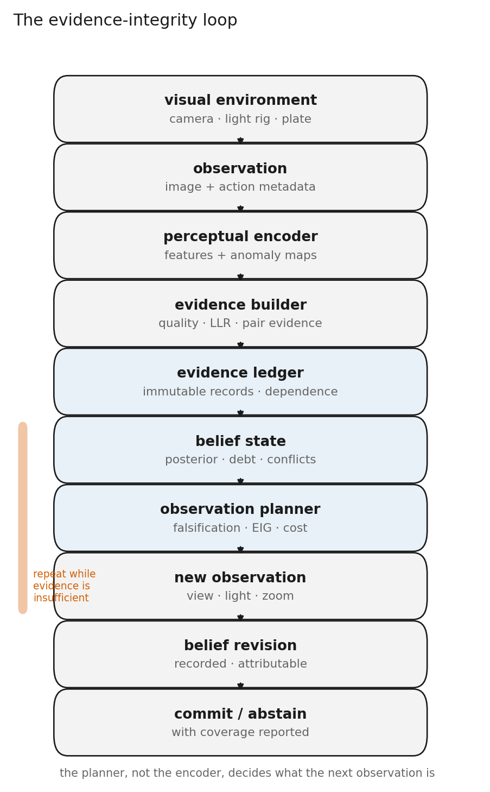

# RHAN-Bi v1 — Evidence-Integrity Active Perception

`RHAN-Bi-v1` is the research programme for **RHAN Brilliancy**: a visual perception system that does not
only report what it thinks is present, but maintains a traceable account of *why*, measures the
quality and independence of its own evidence, actively seeks the observation most likely to refute
its leading interpretation, and revises its belief only when the evidence supports it.

The hypothesis is narrow and testable:

> A reliability- and dependency-aware, falsification-directed observation policy reduces visual
> decision error at a fixed observation budget more effectively than random, confidence-driven, or
> conventional information-gain observation selection.

Everything in this folder exists to make that sentence falsifiable, or to find out that it is false.



The loop is one control flow: an observation becomes an immutable record, the record updates a
traceable belief, and the belief chooses the next observation — or commits, or abstains.

## What is in this folder

| Path | Contents |
|---|---|
| `docs/00_VISION.md` | the scientific identity, the three principles, what RHAN-Bi is not |
| `docs/01_THESIS_AND_HYPOTHESES.md` | H1–H4, nulls, primary endpoint, pre-registration skeleton |
| `docs/02_ARCHITECTURE.md` | the six components, their interfaces, and the system invariants |
| `docs/03_EVIDENCE_LEDGER.md` | the evidence record schema, hashing, provenance, dependency graph |
| `docs/04_EVIDENCE_QUALITY.md` | quality, reliability, dependence and conflict as four separate measurements |
| `docs/05_BELIEF_STATE_AND_REVISION.md` | hypotheses, the update rule, contradiction detection, evidence debt |
| `docs/06_OBSERVATION_PLANNER.md` | the decision objective, its terms and defaults, the baselines |
| `docs/07_TRAINING_PROGRAM.md` | stages A–E, losses, acceptance criteria, compute budget |
| `docs/08_SIMULATOR_SPEC.md` | the inspection laboratory: geometry, actions, ground truth, API |
| `docs/09_EXPERIMENTS_AND_GATES.md` | Gates A–E, protocols, go/no-go rules, artifact paths |
| `docs/10_EVALUATION_STATISTICS.md` | metrics, confidence intervals, paired tests, multiplicity |
| `docs/11_DATA_AND_SCENARIOS.md` | splits, leakage control, scenario matrix, real-data plan |
| `docs/12_INFRA_REPRODUCIBILITY.md` | hardware, seeds, caching, hashes, run manifests |
| `docs/13_RISKS_ETHICS_LIMITS.md` | risk register, ethics, what would invalidate the programme |
| `docs/14_LITERATURE_AND_NOVELTY.md` | what is established, closest prior art, novelty audit protocol |
| `docs/15_ROADMAP.md` | the 16-week plan, gate by gate |
| `docs/16_GLOSSARY.md` | terms used with a fixed meaning |
| `docs/17_REFERENCES.md` | sources with a provenance status column |
| `docs/18_UNREAL_HANDOFF.md` | the contract for the simulation developer |
| `docs/19_DEMO_RESULTS.md` | the measured output of the CPU demo in this repository (written after the run) |
| `rhan_bi/` | the implementation |
| `configs/` | YAML configurations for the demo and each gate |
| `tests/` | the pytest suite (CPU, seconds) |
| `figs/` | six figures: the loop, the architecture, the ledger, the gates, the planner, the scenario plate |
| `results/` | run artifacts (JSON reports, per-episode traces) |

## How to read it

Read `docs/00_VISION.md` and `docs/01_THESIS_AND_HYPOTHESES.md` first. They are the argument. Everything
else is either a specification of how to measure the argument or a tool for measuring it.

The documents were written before the code, as the programme's operating rule. Where the code and a
document disagree, the document is the specification and the code is the defect — except where
`docs/19_DEMO_RESULTS.md` reports what was measured, which cannot be edited into agreement with a
prediction.

## What runs today

The implementation in `rhan_bi/` is a complete, CPU-runnable version of the loop on a deterministic
synthetic inspection laboratory. It does not require a GPU, a dataset download, or Unreal.

```bash
cd RHAN-Bi-v1
python -m rhan_bi.cli demo          # ~3 min on CPU: builds the lab, runs Gates A–E at demo scale
python -m rhan_bi.cli verify        # re-checks ledger hashes, posterior normalisation, splits
python -m pytest tests -q           # fast unit and end-to-end tests
python figs/make_figures.py         # regenerate the schematics and the scenario plate
```

The demo writes `results/demo_report.json`, `results/demo_report.md` and
`results/episodes.jsonl`. Its measured numbers are reported in `docs/19_DEMO_RESULTS.md`.

## Status and honesty

This is **v1 of a research programme, not a validated system**. The simulator is the laboratory, not
the world: results on it establish that the mechanism works under controlled conditions that the
authors designed, and nothing more.

At demo scale (N = 120, budget 3) Gates A–D pass and Gate E is **inconclusive**: falsification-directed
selection did not separate from EIG, and the oracle headroom was 0.008, too small for the sample to
resolve. That is reported in `docs/19_DEMO_RESULTS.md` as a finding, not hidden. The demo establishes
that the loop and the gates execute; it does not confirm H1. The documents state which claims are hypotheses, which are
engineering facts about this code, and which are still unknown. `docs/13_RISKS_ETHICS_LIMITS.md` is
part of the deliverable, not an appendix.

## Relationship to earlier RHAN work

RHAN-Bi does not modify Gen-1, Gen-2, RHAN-NXA or the RHAN-IM packages. It reuses two findings:

- **Dependence matters.** RHAN-IM measured a variance inflation factor of ≈11.6 between repeated
  observations, meaning sixteen looks are worth far fewer than sixteen independent measurements.
  RHAN-Bi makes dependence a first-class quantity in the belief update rather than a post-hoc caveat.
- **Risk control without coverage is not perception.** RHAN-IM's Gate 2 satisfied a risk constraint
  by abstaining on roughly 89 % of scenes. RHAN-Bi reports coverage beside every risk number and
  treats a low-coverage certificate as a failure of the system, not a success of the certificate.
