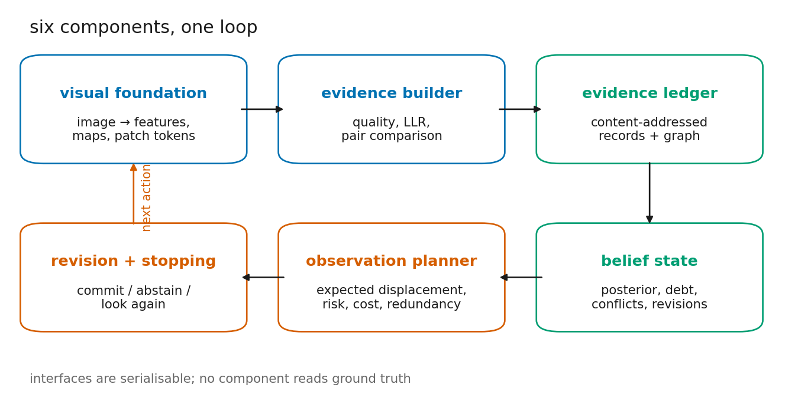

# 02 — Architecture



## 1. One loop, six components

RHAN-Bi is not a multi-agent system. It is one loop with six components, each independently
measurable:

```
 visual environment (simulator / camera)
        │
        ▼
 [1] Visual foundation ──► observation features, patch tokens, anomaly maps
        │
        ▼
 [2] Evidence builder ──► EvidenceRecord (quality, features, LLRs, pair evidence)
        │
        ▼
 [3] Evidence ledger ───► immutable records, dependence graph, provenance
        │
        ▼
 [4] Belief state ──────► posterior over causes, contradictions, evidence debt
        │
        ▼
 [5] Observation planner ─► next action (view / light / zoom)
        │
        ▼
 [6] Belief revision + stopping ─► commit, abstain, or continue
        │
        └────────────► back to the environment
```

The loop's state is `(ledger, belief)`. The only thing that changes the belief is a record; the only
thing that creates a record is an observation; the only thing that chooses an observation is the
planner, which reads the belief and the ledger. That is the whole control flow.

## 2. Components

### [1] Visual foundation

Responsibilities: encode an image into (a) a compact feature vector used by the evidence model,
(b) a spatial anomaly map used for localization and pair comparisons, (c) patch tokens for the
optional DINOv2 path.

Interfaces (`rhan_bi/perception/`):

```python
class Backbone(Protocol):
    name: str
    def encode(self, image: np.ndarray) -> Encoding: ...   # features, patch_tokens, grids
```

`Encoding` carries `features: np.ndarray (D,)`, `patch_tokens: np.ndarray (N, D) | None`,
`maps: dict[str, np.ndarray]` (dark-ridge, bright-ridge, soft-dark responses at the observation's
resolution), and `meta: dict`.

Two implementations:

- `HandcraftedBackbone` — the default. Physics-motivated matched filters and low-pass responses on a
  high-pass image; deterministic, CPU, ~5 ms per 96×96 frame.
- `DinoV2Backbone` — optional, loads `checkpoints/dinov2_vits14_pretrain.pth` (ViT-S/14) when PyTorch
  and the checkpoint are present. Produces 384-d CLS and patch tokens; the anomaly maps still come
  from the handcrafted filters so that the evidence model is comparable across backbones.

The backbone is *not* trained end-to-end with the planner. Stage A fits a linear/MLP head on frozen
features; Stage B fits a localization template. See `docs/07_TRAINING_PROGRAM.md` §2 for why.

### [2] Evidence builder

Takes an observation `(image, action, scene metadata available to the agent)` and produces an
`EvidenceRecord`. It never receives ground truth. It computes:

- quality fields (§`docs/04`);
- feature z-scores against the calibration null;
- per-hypothesis log-likelihood ratios from the fitted `EvidenceModel`;
- pair evidence when a comparable earlier observation exists (same view, different illumination):
  `persistence` of the dark anomaly and `bright_shift` of the bright anomaly;
- dependence links to earlier records (structural + measured).

Interface: `rhan_bi/evidence.py::EvidenceBuilder.build(observation, ledger) -> EvidenceRecord`.

### [3] Evidence ledger

An append-only, content-addressed store of `EvidenceRecord`s plus their images (optionally, by hash)
and the dependence graph. Every mutation creates a new record; records are never edited. Verification
recomputes each record's hash.

Interface: `rhan_bi/ledger.py::EvidenceLedger.add(record)`, `.records`, `.get(id)`,
`.dependents(id)`, `.verify()`, `.to_jsonl(path)`.

### [4] Belief state

A discrete posterior over the four world causes (`DEFECT`, `REFLECTION`, `SHADOW`, `NONE`), computed
from the ledger by a documented update rule, plus:

- per-hypothesis evidence debt (a structured list of unresolved weaknesses);
- contradiction flags (records that support a non-leading hypothesis against the leader);
- a revision log (each change of the MAP hypothesis, with the record that caused it);
- reliability read-outs (entropy, risk, margin, effective evidence count).

Interface: `rhan_bi/belief.py::BeliefState.from_ledger(ledger, model, config)`, `.posterior`,
`.map()`, `.entropy()`, `.debt()`, `.revisions`.

### [5] Observation planner

Enumerates legal actions, predicts their outcomes under each hypothesis using a fitted forward model,
and scores them by the objective in `docs/06` §3. Policies are strategies for that score:

`falsification`, `eig`, `uncertainty`, `random`, `fixed_light_first`.

Interface: `rhan_bi/planner.py::Planner.choose(belief, ledger, actions) -> Action`.

### [6] Belief revision and stopping

After each record, the loop asks: commit, abstain, or continue? Stopping is a separate decision from
selection, with its own evaluation (`docs/06` §7). Revision is the operation of recomputing the
posterior from the full ledger — not an incremental tweak — so that dependence and contradictions are
always evaluated against all evidence. Incremental caching is an implementation detail with an
equality test against the full recomputation.

## 3. Invariants

These are enforced in code and tested.

| Invariant | Enforcement |
|---|---|
| records are immutable and content-addressed | `EvidenceRecord` is frozen; `record_id` is the SHA-256 of the canonical payload; `Ledger.verify()` recomputes |
| no ground truth enters the agent | `EvidenceBuilder` accepts `Observation`, whose public fields exclude cause/label; the lab's `ground_truth` is a separate call the runner never forwards |
| the posterior is normalised and finite | `BeliefState` asserts `sum ≈ 1` and rejects non-finite log-weights |
| dependence can only reduce, never increase, the weight of a record | `weight = 1 / max(1, 1 + Σρ)`; unit-tested |
| every belief revision is attributable | each MAP change names the record id that caused it; a revision with no record is a bug |
| no policy sees another policy's outcome during an episode | policies are constructed per episode from `(belief, ledger, action set)` only |
| the planner cannot choose an illegal action | legality is checked by the lab, not trusted from the planner |
| stopping cannot be tuned on test data | thresholds are fitted on the calibration split and frozen into the config |

## 4. Interfaces between components

```python
Observation  = (image, action, view, light, roi, step, scene_id)
Encoding     = (features, patch_tokens, maps, meta)
EvidenceRecord = (record_id, episode_id, step, scene_id, action, features, quality,
                  llr, pair, dependence, provenance)
BeliefState  = (posterior, log_weights, debt, contradictions, revisions, n_eff)
Action       = (kind, view, light, roi, cost)
```

Everything crossing a component boundary is serialisable. That is what allows `results/episodes.jsonl`
to be replayed and audited without re-running the simulator.

## 5. Data flow for one episode

1. Lab creates a scene with a hidden cause and a ground-truth record.
2. Agent requests the initial observation (front view, neutral light, full frame).
3. Builder produces record r1; ledger appends; belief computes posterior p1.
4. Planner scores the legal actions (move light, move view, zoom); chooses a2.
5. Lab renders a2; builder produces r2 and its pair evidence against r1; ledger appends.
6. Belief recomputes from r1, r2; contradiction and debt update; revision may occur.
7. Stopping rule decides commit / abstain / continue. If continue, return to 4 with the remaining
   budget.
8. Runner writes the episode trace: observations, records, posteriors after each step, action costs,
   decision, ground truth (in the results file only, never in the agent's state).

## 6. Failure modes and how they are surfaced

| Failure | Symptom | Surfaced by |
|---|---|---|
| feature drift | likelihoods saturate, posterior becomes 0/1 | `verify` checks calibration residuals; debt flags "out of calibration range" |
| duplicated evidence | confidence rises without accuracy | `n_eff` read-out; H3 ablation |
| circular evidence | a pair record is compared to itself or to a derivative | ledger provenance check; pair requires distinct record ids and distinct images |
| planner myopia | one-step score chooses an action that forecloses the informative one | reported as a limitation; the demo measures the gap to an oracle two-step policy at the same budget |
| simulator overfit | test error far below real-data error | Gate C/D transfer check; `docs/13` risk R2 |
| metric gaming | abstention lowers risk without usefulness | coverage reported beside every risk; abstention counted as error in the primary endpoint |

## 7. Compute envelope

The reference implementation targets a single RTX 4060 (8 GB) and 16 GB RAM, and the demo runs on CPU
in about a minute. Feature extraction is the dominant cost; the belief and planner are negligible.
The DINOv2 path is optional and cached. No component requires more than one GPU. `docs/12` gives the
per-stage estimates.
