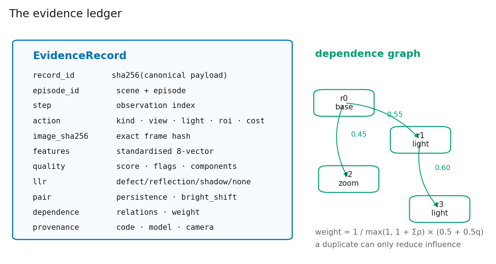

# 03 — The evidence ledger

The ledger is the structural difference between RHAN-Bi and a classifier with a confidence head. It
is an append-only, content-addressed record of every observation the system has made, what that
observation contributes to each hypothesis, how reliable it is, and how much it overlaps with what was
already known.



## 1. Why a ledger rather than a feature buffer

Pooling observations into one vector loses four things that the belief needs:

1. **Identity.** Which look supported which part of the conclusion.
2. **Quality.** Whether a look was blurred, glared or occluded.
3. **Dependence.** Whether two looks are two measurements or one measurement taken twice.
4. **Provenance.** Which processing steps produced the evidence, so a revision can be audited.

The ledger keeps all four. Its cost is memory and bookkeeping; both are trivial at this scale.

## 2. Record schema

The record is a frozen payload; the diagram above is the schema as the code writes it, with the
dependence edges that let a belief discount redundant looks.

An `EvidenceRecord` is a frozen dataclass serialised to canonical JSON. The fields and their types:

| Field | Type | Meaning |
|---|---|---|
| `record_id` | str (64 hex) | SHA-256 of the canonical payload excluding this field |
| `ledger_version` | str | schema version, `"rhan-bi-ledger-v1"` |
| `episode_id` | str | episode identifier (scene + episode seed) |
| `scene_id` | str | simulator scene identifier |
| `step` | int | 0-based observation index within the episode |
| `action` | object | `{kind, view, light, roi, cost}` — what was requested |
| `image_sha256` | str | hash of the exact image array (shape, dtype, bytes) |
| `features` | object | standardised feature vector (see §4); raw values are recoverable with the stored scaler |
| `quality` | object | `{score, flags[], blur, contrast, exposure, glare, occlusion, snr}` |
| `llr` | object | per-hypothesis log-likelihood ratio, `{defect, reflection, shadow, none}` |
| `pair` | object \| null | `{with_record_id, persistence, bright_shift, llr{...}}` |
| `dependence` | object | `{rho_max, relations[{record_id, rho, reason}], weight}` |
| `provenance` | object | `{code_version, feature_version, model_version, backbone, camera, parent_ids[]}` |

`pair` is non-null only when the record can be compared with a previous record from a *different*
illumination at the *same* view. The pair comparison is the one that separates a fixed defect from a
moving reflection, so its provenance is recorded explicitly: the earlier record's id, the image hash
it used, and the two actions.

## 3. Canonical serialisation and hashing

```python
payload = {
    "ledger_version": ...,
    "episode_id": ..., "scene_id": ..., "step": ...,
    "action": {...}, "image_sha256": ...,
    "features": {...}, "quality": {...}, "llr": {...},
    "pair": {...} | None,
    "dependence": {...}, "provenance": {...},
}
record_id = sha256(json.dumps(payload, sort_keys=True, separators=(",", ":"),
                              ensure_ascii=True).encode()).hexdigest()
```

Rules:

- floats are rounded to 6 decimals before hashing (`rf(v) = round(v, 6)`), so that platform-level
  floating-point noise does not break verification;
- no timestamps, hostnames or absolute paths enter the payload (a wall-clock timestamp would make the
  hash unreproducible);
- JSON is emitted with sorted keys and no whitespace, so the same payload always hashes the same;
- `Ledger.verify()` recomputes every id and reports the first mismatch with its field path.

Rounded floats are a deliberate trade: at 6 decimals the hash is stable across the numpy/BLAS
variations observed on this machine, while the evidence values are far coarser than 1e-6.

## 4. Features

Raw features, all computed on the observation's anomaly maps at a fixed resolution:

| Feature | Definition | Range |
|---|---|---|
| `ridge_dark` | max over 4 orientations of the normalised dark-line matched-filter response in the region of interest | [0, ∞) |
| `ridge_bright` | the same for a bright line | [0, ∞) |
| `soft_dark` | low-pass dark deviation (σ = 4 px) in the ROI | [0, ∞) |
| `sharp_ratio` | high-pass energy / total anomaly energy at the argmax | [0, 1] |
| `glare` | fraction of saturated pixels (≥ 250/255) in the ROI | [0, 1] |
| `occlusion` | fraction of the ROI that is flat and mid-grey (an occluder) | [0, 1] |
| `contrast` | robust contrast (p95 − p5) / 255 of the ROI | [0, 1] |
| `snr` | anomaly amplitude / estimated noise σ | [0, ∞) |

The evidence model consumes **standardised** values of these features, using the calibration split's
mean and standard deviation (stored with the model), so a raw feature value never has to be
hand-tuned. The record stores the standardised vector; the raw feature is a pure function of the
image and the feature configuration.

Pair features:

| Feature | Definition | Range |
|---|---|---|
| `persistence` | Pearson correlation between the thresholded dark-anomaly maps of the two observations, after aligning the object region | [−1, 1] |
| `bright_shift` | displacement (px) of the bright-anomaly centroid between the two observations | [0, D] |

A defect is fixed to the object, so its `persistence` is high under a light change. A reflection is
tied to the illumination geometry, so it moves: low `persistence`, non-zero `bright_shift`. A shadow
is soft and moves: low `persistence` and low `sharp_ratio`.

## 5. Dependence graph

Each new record computes a dependence relation to every earlier record in the episode:

```
ρ(a, b) = max over matching structural factors:
    same action kind+view+light+roi  -> 1.00   (a duplicate observation)
    same view, different light       -> 0.55   (pair; shared geometry)
    same light, different view       -> 0.60   (shared illumination)
    same view, same light, diff ROI  -> 0.45   (overlapping pixels)
    otherwise                        -> 0.10   (common scene only)
```

The weights are design constants, not measurements. They are chosen conservatively (a pair that *is*
the disambiguating measurement still shares the object geometry) and they are checked against the
empirical correlation of the feature residuals on the calibration split; `docs/04` §5 reports the
comparison and the code prints it (`verify --dependence-report`).

The record's usable weight is

```
weight = 1 / max(1, 1 + Σ_{r' ∈ previous} ρ(r, r'))
```

so a record that duplicates an existing one contributes ½, a record that duplicates two contributes
⅓, and a record that duplicates nothing contributes 1. The weight is stored in the record
(`dependence.weight`) so a replay does not have to recompute it. It is *not* allowed to exceed 1.

## 6. Provenance

`provenance` ties a record to the code and the observation that produced it:

| Key | Example | Purpose |
|---|---|---|
| `code_version` | `"rhan-bi-1.0.0"` | the package version that wrote the record |
| `feature_version` | `"features-v1"` | bumping a feature definition invalidates old likelihoods |
| `model_version` | `"evidence-model-<hash>"` | fit identifier of the likelihood model |
| `backbone` | `"handcrafted"` or `"dinov2_vits14"` | which encoder produced the features |
| `camera` | `{view, light, roi}` | the physical observation parameters |
| `parent_ids` | `["<r1>"]` | records this one was derived from (pair comparisons) |

A record whose `feature_version` differs from the current model's is rejected by `BeliefState` with a
clear error rather than silently mis-scored — a stale feature is worse than a missing record.

## 7. Lifecycle

```
observe -> build -> append -> (belief recompute) -> plan -> stop?
```

- **No updates.** A record is written once. A correction is a new record with `parent_ids` naming the
  one it corrects, and the belief recomputes from both.
- **No deletion.** Records that are later judged unreliable stay in the ledger with their quality
  flags; the belief can down-weight them but cannot forget them. `debt` records that a record was
  discounted, so the audit trail explains the posterior.
- **Bounded memory.** Images are kept in an LRU keyed by hash, size `max_images` (default 256). A
  record's `image_sha256` remains valid after eviction; the pair computation is the only consumer of
  images, and it happens before eviction.
- **Serialisation.** `Ledger.to_jsonl()` writes one record per line; `Ledger.from_jsonl()` verifies
  every id on load. The demo writes `results/episodes.jsonl` with the full trace.

## 8. Integrity checks (`rhan_bi.cli verify`)

1. every `record_id` recomputes from its payload;
2. `image_sha256` matches the stored image when the image is still resident;
3. `pair.with_record_id` exists, precedes the record, and has a different light and the same view;
4. `dependence.relations` reference existing, earlier records and `weight` equals the rule in §5;
5. `llr` keys are exactly the four hypotheses and all values are finite;
6. posteriors recomputed from the ledger equal the stored posteriors to 1e-9;
7. no record carries a ground-truth field.

Check 7 is a schema assertion: `EvidenceRecord` has no `cause` field at all, and the builder's input
type does not expose one. The verify command additionally scans serialised records for the substring
`"cause"` and fails if it appears.

## 9. What the ledger cannot do

- It cannot tell whether a record's *content* is truthful; it only proves the content is what was
  recorded.
- It cannot detect a systematically miscalibrated feature model; that is the calibration split's job.
- It cannot represent evidence that was never acquired. Absence of a record is not evidence of
  absence, which is why occlusion produces debt rather than support for `NONE`.
- It cannot undo a record; a wrong observation remains visible in the audit trail, which is the point.
