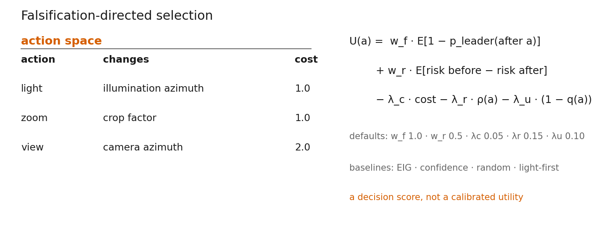

# 06 — The observation planner



## 1. Action space

An action is a request to the environment:

```python
Action(kind="light" | "view" | "zoom" | "base",
       view=0 | -1 | +1,          # camera azimuth index: front, left, right
       light=0 | 1 | 2,           # illumination azimuth: left, centre, right
       roi=None | (x0, y0, x1, y1),
       cost=float)
```

Legality constraints are enforced by the lab: a `view` action must change the view; a `light` action
must change the light; `zoom` may be repeated (it doubles the crop factor up to 2× and then becomes
a near-duplicate, which the dependence rule penalises).

Costs (design constants, reported with every result):

| Action | Cost | Rationale |
|---|---|---|
| `light` | 1.0 | a switch or a second illuminator; cheap and fast |
| `zoom` | 1.0 | a motorised zoom or a crop request |
| `view` | 2.0 | a robot move; slower and riskier |

The budget is expressed in observations, not in cost, for the primary comparison, so that the policy
comparison is not confounded by cost accounting. Cost matters in the secondary cost-weighted endpoint
and inside the planner's objective.

## 2. What the planner predicts

The planner cannot see the true cause. It has:

- the current posterior;
- the fitted likelihood model (which gives `p(features | cause)`);
- a fitted **forward model** that predicts how the feature distribution depends on the action:
  `p(features | cause, action, state)`.

The forward model is a per-cause, per-action-type Gaussian fitted on calibration episodes:

```
μ[cause, kind], σ[cause, kind]
```

with `kind ∈ {base, light, view, zoom}`. For pair-producing actions (`light` at an existing view) it
also predicts `persistence` from the per-cause Gaussian in `docs/05` §3. This is a learned model of
*the agent's own sensor and environment*, not access to ground truth: it is fitted before the test
split is touched, and it is wrong wherever the simulator is wrong.

Outcomes are sampled from this predictive (Monte Carlo, `n_samples = 64` per action by default,
common random numbers across actions to reduce variance), and each sample is scored through the same
likelihood model the belief uses. The result is an approximate expected posterior for each action.

## 3. Objective

For an action `a` with cost `c(a)`, dependence with the ledger `ρ(a)` and predicted quality `q(a)`:

```
U(a) = w_f · E[ 1 − p_{h*}(posterior after a) ]      # expected displacement of the leader
     + w_r · E[ risk(current) − risk(after) ]        # expected risk reduction
     − λ_c · c(a)/c_max
     − λ_r · ρ(a)
     − λ_u · (1 − q(a))
```

Defaults: `w_f = 1.0`, `w_r = 0.5`, `λ_c = 0.05`, `λ_r = 0.15`, `λ_u = 0.10`. The first term is the
falsification term: it is maximized by an observation that is expected to unseat the current leader,
regardless of whether the alternative is a specific rival. The second term keeps the policy from
ignoring cheap risk reduction when no action is expected to falsify anything.

The objective is a **decision score, not a probability or a utility in the von Neumann–Morgenstern
sense**. It is not calibrated and it is not compared across tasks. It is compared across actions
inside one episode, which is all it is used for.

The weights are frozen in `configs/gate_e.yaml` before the confirmatory run and are the same for
every scene. They were chosen by a sensitivity sweep on the *calibration* split only; the sweep and
its results are reported (`results/planner_sweep.json`), and the fact that a sweep happened is part of
the pre-registration.

## 4. Falsification-directed selection

The distinguishing behaviour is not the formula but the ordering it induces. Consider three actions
on a defect/reflection scene after one observation:

| Action | Expected effect | Falsification term | Risk term |
|---|---|---|---|
| zoom | sharper ridge, same geometry | small: leader barely moves | moderate |
| view change | parallax + new specular geometry | moderate: both causes predict change | moderate |
| light change | persistence measurement becomes available | **large**: a defect persists, a reflection does not | large |

A policy that maximizes expected information gain also prefers the light change here, which is why
EIG is the serious baseline and not a straw man. The falsification policy differs in *what it does
next*: after the light change, if the leader survives, its remaining debt is low and it commits; if
the leader is displaced, it does not "average" the two looks — the pair evidence is decisive and the
revision is recorded. EIG, maximizing entropy reduction, has no preference between confirming and
refuting, and in scenes with three or more plausible causes it can spend budget resolving uncertainty
about a cause the decision does not depend on.

Whether that difference is large enough to matter is the experiment. It may not be. The Gate E
report will say so.

## 5. Baselines

All baselines use the same features, likelihood model and forward model. Only the selection rule
differs. `confidence` is the policy the three principles argue against: it prefers the observation
that is expected to make the current answer more certain, whether or not that observation could
reveal the answer to be wrong.

| Policy | Rule |
|---|---|
| `random` | uniform over legal actions not already taken; seeded |
| `confidence` | maximize the expected posterior of the current leader — a confirmation-seeking policy |
| `eig` | maximize expected mutual information between the observation and the cause |
| `fixed_light_first` | deterministic sequence: light-left, view-left, light-right (a strong hand-designed industrial protocol) |
| `falsification` | §3 with `w_f = 1, w_r = 0.5` |
| `oracle` (reported, not deployable) | chooses the action that maximizes *realised* final correctness with the remaining budget, using ground truth; an upper bound on what selection can do |

The oracle is included because a null result for H1 is ambiguous without it: if falsification ≈ EIG ≈
oracle, the task has no headroom and the experiment cannot distinguish mechanisms. If falsification ≈
EIG ≪ oracle, the planner class is the limitation.

## 6. Tie-breaking and determinism

- Ties within 1e-9 are broken by a fixed priority: `light > zoom > view`, then by action index.
- The Monte Carlo sampling uses a generator seeded from `(episode_seed, step)` so a replay is exact.
- Floating-point differences between BLAS builds can change a near-tie; the deterministic tie-break
  keeps the chosen action stable, and the tests assert equality across two runs in one process.

## 7. Stopping

Stopping is evaluated as carefully as selection:

| Rule | Definition |
|---|---|
| commit | `max p ≥ τ_commit` and `debt ≤ τ_debt` |
| abstain | budget exhausted and `margin < τ_abstain_margin` |
| value stop | expected falsification + risk gain of the best remaining action < its cost |
| budget | hard cap, `B = 3` in the primary comparison |

The value-stop uses the same forward model as selection, so its errors are correlated with the
planner's. That is a known limitation, reported in `docs/13` (risk R5). The alternative — a separate
held-out stopping model — is specified for Gate D but not implemented in v1.

For the primary endpoint every policy takes exactly `B` observations, so stopping does not confound
the comparison. The secondary endpoint uses each policy's own stopping rule and reports error,
coverage (fraction committed) and mean observations.

## 8. Evaluation of the planner

Per episode and per policy, the runner records:

```
final posterior, decision, abstained, n_observations, total_cost,
action sequence, per-step expected score (predicted) and realised outcome,
whether the leader changed, and which record caused the change.
```

Predicted versus realised is reported because a planner that is well calibrated in its predictions
but wrong about the world is a different failure from a planner that predicts badly. The demo prints
the correlation between predicted displacement and realised displacement for the chosen action
(`results/demo_report.md` §5).

## 9. What the planner cannot do in v1

- **Multi-step lookahead.** It is greedy, one action ahead. The oracle gives a bound on the cost of
  myopia but not a remedy.
- **Learn from experience.** No RL; weights are fixed. A learned policy is a later gate.
- **Reason about physical interventions it cannot perform.** It can change viewpoint, light and zoom;
  it cannot move the object, remove an occluder, or wait for a process to change.
- **Know when its forward model is wrong.** Out-of-range predictions produce an `OUT_OF_RANGE` debt
  item but do not stop the planner from using them.
