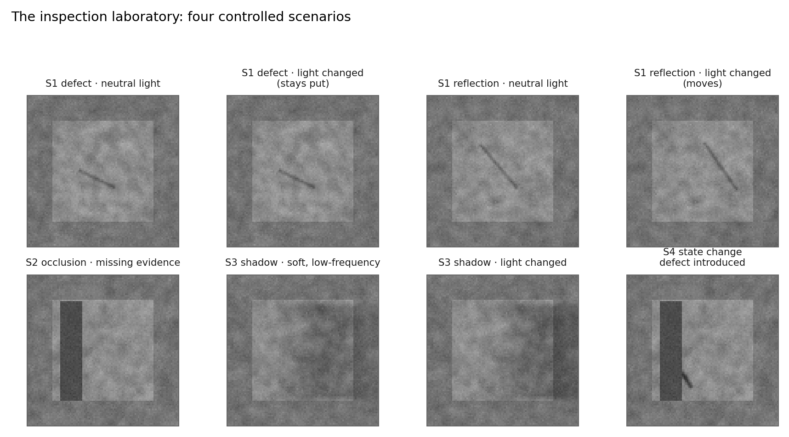

# 08 — The inspection laboratory (simulator v1)

The simulator is the laboratory in which the loop is measured. It is not a game, a city or a digital
twin. It is a small, deterministic, programmable tabletop inspection scene whose ground truth is exact
and whose observations can be intervened on one variable at a time.



## 1. Why a simulator at all

The scientific question needs three things that a real dataset cannot provide together:

1. **Known cause.** Whether a dark streak is a defect, a reflection or a shadow is recorded, not
   annotated by a human who may be wrong.
2. **Controlled intervention.** The same scene can be re-observed under a changed light with
   everything else fixed. That is the only way to measure persistence as a causal cue.
3. **Counterfactual pairs.** For every scene we can say what *would* have been observed under a
   different action, because we can render it.

The price is external validity. That price is paid explicitly at Gates C and D with a real-data
transfer check, and the limits are stated in `docs/13`.

## 2. Scene model

A scene is a 2.5-D tabletop view: a textured metal plate, an anomaly on or near its surface, a light
rig and a camera that can move left/right and zoom. Geometry is orthographic with a small parallax
shift for view changes; there is no perspective, no BRDF, no inter-reflection and no cast shadows from
the plate itself.

```
canvas: 96 × 96 float32 in [0, 1]        (128 × 128 optional)
plate:  rectangle [16, 80)², textured grey 0.55 ± 0.02
background: grey 0.45 ± smooth texture
```

Scene parameters:

| Parameter | Values | Notes |
|---|---|---|
| `cause` | `defect`, `reflection`, `shadow`, `none` | balanced by construction |
| `gloss` | 0.30 ± 0.05 for defect/shadow/none; 0.85 ± 0.05 for reflection | affects the specular halo |
| `defect` | centre ∈ [30, 66]², θ ∈ [0, π), length ∈ [22, 38] px, width σ ∈ [0.8, 1.1] px, amplitude ∈ [0.18, 0.30] | dark line |
| `reflection` | same shape family, amplitude ∈ [0.15, 0.28]; centre shifted by light and view (§3) | dark streak with a bright halo |
| `shadow` | soft bar, σ = 4.5 px, width 18 px, amplitude ∈ [0.12, 0.22]; centre shifted by light | low-frequency |
| `occluder` | bar covering 12–25 % of the plate (scenario S2, and 20 % of S1/S3 scenes) | drawn last; hides everything under it |
| `texture_seed` | derived from `scene_id` | fixed for the scene across observations |

The render is a sum of terms, then clamped and noised:

```
I = plate_texture
  − A_d · exp(−d_perp² / 2σ_d²)                     (defect, fixed in object coordinates)
  − A_r · exp(−d_perp(light)² / 2σ_r²)              (reflection: position depends on light)
  + 0.10 · exp(−(d_perp(light) − 1.5)² / 2)         (reflection bright halo)
  − A_s · exp(−(x − x_s(light))² / (2 · 18²))       (shadow: soft vertical bar)
  + occlusion_bar
  + N(0, 0.02²)
I = clip(I, 0, 1)
```

### 3. Intervention model (the part that matters)

| Variable | Effect on the image | Ground truth exposed |
|---|---|---|
| `light` azimuth ∈ {left, centre, right} | shifts the reflection streak by 14 px per step; shifts the shadow by 10 px per step; **does not move the defect** | the contrast between fixed and moving anomalies |
| `view` ∈ {front, left, right} | shifts the whole object by 4 px (parallax); additionally shifts the reflection by 6 px (specular geometry depends on viewpoint) | parallax consistency |
| `zoom` ∈ {1×, 2×} | crops the central 48 × 48 and upsamples to 96 × 96 | resolution, not identifiability |

The defect is fixed to object coordinates and therefore translates by exactly the object's parallax
under a view change. The reflection translates by parallax **plus** its light/view-dependent offset.
The shadow is soft and moves with the light. These offsets are the physical signal the pair features
measure, and they are the reason a light change is informative while a zoom is not.

## 4. Observations

An observation is a dictionary the agent may read:

```python
{
  "image": np.ndarray (H, W) float32,     # the rendered frame
  "action": {"kind": ..., "view": ..., "light": ..., "roi": ...},
  "step": int,
  "scene_id": str,
  "roi": (x0, y0, x1, y1),
}
```

It deliberately contains **no cause, no defect mask, no gloss, no light object**. Those live in
`lab.ground_truth()`, which the episode runner calls only after the decision is made, and writes to the
results file, never to agent state. This separation is enforced by type: `Observation` is a frozen
dataclass with no cause field, and `EvidenceBuilder` accepts only `Observation`.

## 5. API

```python
lab = InspectionLab(config, scene=scene)          # one scene, one episode
obs0 = lab.reset()                                 # base observation, cost 0
obs1 = lab.observe(Action(kind="light", light=2))
obs2 = lab.observe(Action(kind="view", view=-1))
obs3 = lab.observe(Action(kind="zoom"))
gt    = lab.ground_truth()                         # AFTER the decision
```

| Call | Returns | Raises |
|---|---|---|
| `reset()` | initial observation | if called twice without `new_scene` |
| `observe(action)` | observation | `IllegalAction` if the action does not change the requested variable, exceeds the budget, or repeats a view that does not exist |
| `ground_truth()` | `{cause, defect_mask, location, gloss, light, view, occluder, seed}` | — |
| `advance_scene(mutation)` | new observation of the mutated scene (S4) | if mutation is unknown |
| `legal_actions()` | list of actions not yet taken, with costs | — |

The lab owns the budget counter. A policy cannot exceed it by construction; the runner also checks.

## 6. Ground truth schema

```json
{
  "scene_id": "s000123",
  "episode_id": "s000123-e0",
  "cause": "reflection",
  "defect_mask_sha256": "...",
  "defect_centre": [48.2, 41.7],
  "defect_angle_rad": 0.61,
  "gloss": 0.87,
  "occluder": null,
  "scenario": "S1",
  "seed": 123
}
```

`defect_mask_sha256` hashes the rasterised mask so that a claim about localization can be checked
without shipping the mask. For `none` scenes the mask is empty and the hash is of an all-zero array.

## 7. Scenarios

| ID | Name | Construction | What it tests |
|---|---|---|---|
| S1 | reflection vs damage | cause ∈ {defect, reflection}, gloss high for both, no occluder | the core ambiguity; light change is decisive |
| S2 | occlusion | cause ∈ {defect, reflection}; an occluder covers 12–25 % of the plate, sometimes over the anomaly | does the system recognise missing evidence rather than infer absence? |
| S3 | shadow vs physical variation | cause ∈ {defect, shadow} | soft vs sharp; light change separates |
| S4 | actual state change | start with `none`, `advance_scene("introduce_defect")` at step 1 | does the system flag a contradiction and revise rather than average? |

Scenario S4 is implemented in the lab and exercised by one test; it is **not** part of the Gate E
primary endpoint. It exists to show the belief does something sensible when the world changes, and to
document what is not solved (no explicit change-point model).

## 8. Determinism

- scene content is a pure function of `(seed, scenario)`;
- observation noise is seeded from `(seed, step, action_index)` so a replay reproduces exactly;
- the renderer uses only numpy float64 accumulation and a fixed Gaussian kernel cache;
- there is no wall-clock, no thread pool and no GPU in the simulator path;
- `tests/test_simulator.py` asserts bitwise equality of two renders of the same scene and action.

## 9. Realism defence

The simulator is simple, but it is not rigged to make one policy win:

1. **All policies share the same features and model.** The comparison varies only the selection rule.
2. **The discriminating cue is physical, not planted.** The defect is static and the reflection moves
   because that is how the two phenomena differ; a zoom cannot fake a light change.
3. **A strong hand-designed baseline exists.** `fixed_light_first` encodes what a competent industrial
   protocol would do, and EIG is a principled adaptive policy. Falsification must beat them, not just
   random.
4. **Single-observation ambiguity is measured, not assumed.** Stage A's acceptance band requires
   defect-vs-reflection to be imperfect; if it comes out perfect, the scene generator is reviewed.

What the simulator cannot defend: its rendering is not calibrated radiometrically, its reflection is a
shifted streak rather than a physical BRDF, and its defects are 2-D. Those are stated as limitations,
not hidden.

## 10. Unreal Engine path

The simulator is a reference implementation of an interface, not a competitor to Unreal. A production
laboratory (S1–S4 at higher fidelity, with real materials and lighting) must satisfy the same API and
the same ground-truth schema; `docs/18_UNREAL_HANDOFF.md` is the contract, including acceptance tests
that the Unreal build must pass before its data can be used in Gate D/E. The Python `InspectionLab`
and a future `UnrealLab` are interchangeable behind `LabProtocol`:

```python
class LabProtocol(Protocol):
    def reset(self) -> Observation: ...
    def observe(self, action: Action) -> Observation: ...
    def legal_actions(self) -> list[Action]: ...
    def ground_truth(self) -> dict: ...
    def advance_scene(self, mutation: str) -> Observation: ...
```

## 11. Parameters that are fixed and parameters that may vary

Fixed for v1 (a change is a new simulator version and invalidates comparisons):

- canvas size, plate rectangle, kernel widths, noise σ, light offsets, view parallax;
- costs, budget, action legality.

Allowed to vary between runs, recorded in every result file:

- number of scenes, seeds, scenario mix, class balance, occluder rate;
- the perception backbone (handcrafted vs DINOv2) — but both arms of a comparison must use the same
  backbone.

The version string `inspection-v1.0` is stamped into every record's provenance and every result file.
