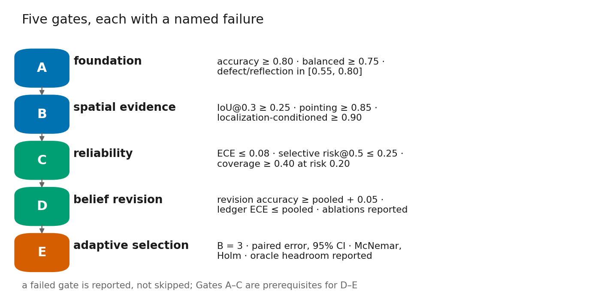

# 09 — Experiments and gates

Five gates, each with a question, a protocol, an endpoint, a pass rule and a named failure. A gate
that fails is a result; it is reported and the next gate does not silently proceed.

The demo in this repository runs every gate at reduced N to prove the pipeline executes. Those numbers
are feasibility, not confirmation, and are labelled as such.

## Gate A — Foundation competence

**Question.** Is the single-observation encoder competent enough for the rest of the programme to be
about evidence rather than about a broken feature extractor?

| Item | Value |
|---|---|
| Data | 400 train / 100 calib / 100 dev / 400 test scenes, one base observation each |
| Model | handcrafted features → multinomial logistic regression; optional DINOv2-S → linear |
| Endpoint | dev accuracy; balanced accuracy; 4×4 confusion |
| Pass | accuracy ≥ 0.80, balanced ≥ 0.75, defect-vs-reflection balanced accuracy in [0.55, 0.80] |
| Fail | accuracy < 0.80 → feature/model defect; defect/reflection ≈ 1.0 → simulator leaked a cue |
| Artifact | `results/stage_a.json`, `results/confusion_single_observation.json` |

The [0.55, 0.80] band is unusual and intentional. If a single observation resolves defect from
reflection perfectly, the core experiment has no ambiguity to resolve and the simulator must be fixed
before Gate D.

## Gate B — Spatial evidence

**Question.** Does the system know *where* the evidence is, or only *what* it is?

| Item | Value |
|---|---|
| Data | Gate A scenes with rasterised defect masks |
| Model | learned dark-ridge template + threshold; pointing game |
| Endpoint | IoU@0.3, pointing accuracy (a predicted-mask pixel within 4 px of the defect), peak pointing (reported separately), localization-conditioned accuracy |
| Pass | IoU ≥ 0.25, pointing ≥ 0.85, localization-conditioned ≥ 0.90 |
| Fail | high accuracy with low pointing → the classifier uses a scene-level shortcut and Gate A must be re-examined |
| Artifact | `results/stage_b.json` |

## Gate C — Evidence reliability

**Question.** Can the system say when its evidence is unreliable, and does it abstain usefully rather
than theatrically?

| Item | Value |
|---|---|
| Data | calibration split for all fits; dev split for every reported number |
| Models | temperature scaling; quality→error logistic model; conformal risk control |
| Endpoints | ECE (15 bins), Brier, NLL; selective risk at coverage 0.5; coverage at risk ≤ 0.20 |
| Pass | ECE ≤ 0.08; selective risk at 0.5 ≤ 0.25; coverage at risk 0.20 ≥ 0.40 |
| Fail | risk target met only by abstaining on > 60 % of scenes — the Gate 2 failure mode. The 0.20 target is a design decision for a task with a deliberately ambiguous single look (docs/07 §4); a 0.10 target at 40 % coverage is not attainable from an 80 % base classifier |
| Artifact | `results/stage_c.json`, `results/risk_coverage.json` |

The coverage floor is the most important number in this gate. A risk certificate with no coverage is
not a perception system, and this programme will not report one as a success.

## Gate D — Belief revision

**Question.** When a disambiguating observation arrives, does the belief move to the truth, and does
dependence discounting prevent the overconfidence that repeated looks produce?

| Item | Value |
|---|---|
| Data | 600 calibration / 200 dev episodes; fixed schedule base → light → zoom for fitting |
| Arms | `ledger`, `pooled`, `no_pair`, `no_dep` |
| Endpoints | final accuracy; revision accuracy; ECE; NLL; n_eff; contradiction rate; abstention |
| Pass | revision accuracy ≥ pooled + 0.05 (95 % CI > 0); ledger ECE ≤ pooled; `no_dep` shows higher confidence at equal accuracy |
| Fail | no revision advantage → the ledger adds bookkeeping, not capability; report and reconsider the contribution |
| Artifact | `results/stage_d.json`, `results/revision_traces.jsonl` |

The pair ablation (`no_pair`) is the H4 test: without a light change, the belief should be stuck near
the Stage A ceiling no matter how many zooms it takes. If it escapes without pair evidence, some other
feature is leaking the cause.

## Gate E — Adaptive observation

**Question.** At a fixed budget, does falsification-directed selection reduce decision error?

| Item | Value |
|---|---|
| Data | 400 test scenes, never used for any fit, fixed seed list |
| Policies | falsification, EIG, confidence, random, fixed_light_first, oracle |
| Budget | B = 3 observations per scene, identical seeds across policies |
| Primary | mean per-scene decision error, paired falsification − EIG, 95 % bootstrap CI, McNemar |
| Secondary | error vs confidence/random; cost-weighted error; abstention; calibration; n_eff; predicted-vs-realised |
| Pass | CI upper bound < 0, Holm-corrected McNemar p < 0.05, point estimate ≤ −0.05 |
| Fail | CI includes 0 → H1 not supported; report the null, do not reinterpret the endpoint |
| Artifact | `results/stage_e.json`, `results/episodes.jsonl` |

The oracle policy (ground-truth-selected action) is reported as a headroom bound. If all deployable
policies are close to the oracle, the task lacks headroom and the null is uninformative about
mechanism; that case is reported as inconclusive rather than as evidence for H1.

## Pre-registration and ordering

The confirmatory Gate E run requires:

1. `docs/01` §6 frozen by commit before the test seed list is used;
2. `configs/gate_e.yaml` weights frozen in the same commit;
3. a recorded feasibility run (the demo) that is explicitly not confirmatory;
4. no change to features, model, policies or thresholds after the freeze.

Checks 1–4 are verified by `python -m rhan_bi.cli verify --gate-e-freeze` against the config hash
stored in `results/stage_e.json`.

## What each gate can and cannot establish

| Gate | Establishes | Does not establish |
|---|---|---|
| A | the encoder is competent on this simulator | competence on real images |
| B | evidence is localized | that localization is causally used by the belief |
| C | reliability is measurable and useful *in distribution* | calibration under real distribution shift |
| D | the ledger improves revision *in this simulator* | that the improvement transfers to a factory |
| E | one selection rule beats others at fixed budget *here* | a general law about active perception |

The rightward column is not a formality. Every claim in the eventual paper must live in the left
column, and the right column must appear in the limitations section.

## Deviations and failures

- A failed gate is recorded in `results/gates.json` with `status: FAIL` and the numbers that caused it.
- A gate may be re-run only with a new config hash; the earlier attempt stays in the record.
- Any change to a threshold after seeing a gate's dev results is a deviation; the affected gate becomes
  exploratory for that run.
- A gate that cannot run (missing dependency, simulator error) is `BLOCKED`, never `PASS`.

## Demo scale

The demo uses 240 train / 120 calib / 120 test scenes, B = 3, 120 test scenes for Gate E, and it runs
in about a minute on CPU. Its numbers are in `docs/19_DEMO_RESULTS.md` and are not confirmatory. The
demo exists to answer one question before the confirmatory run: *does the pipeline produce a signal
worth testing properly?*
